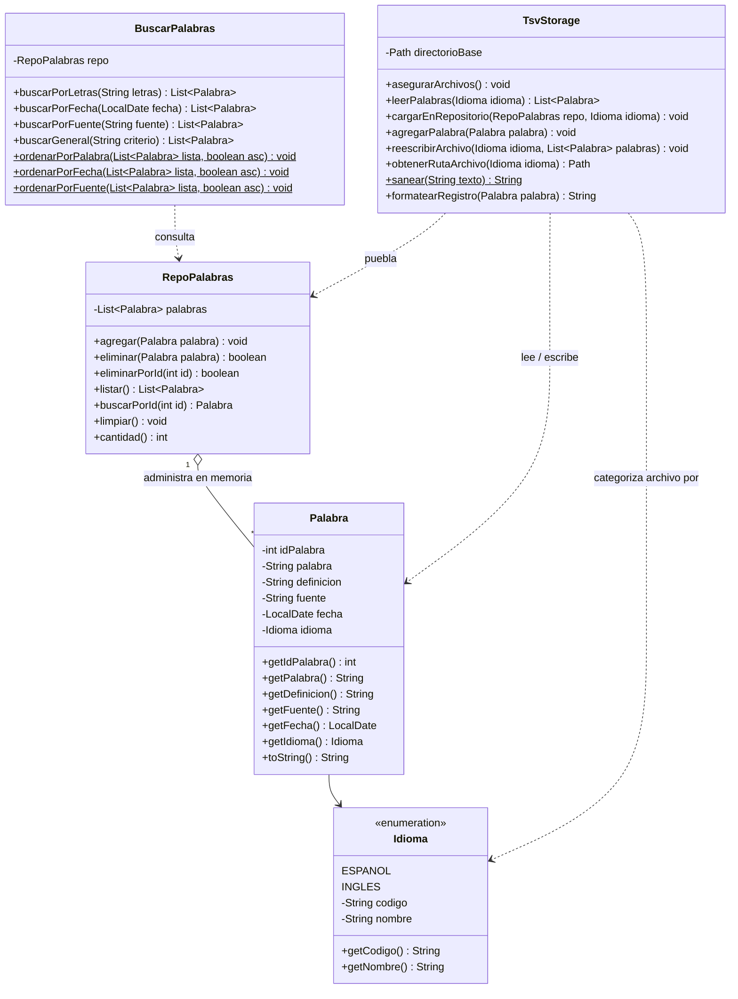

# UML y Especificación de Casos de Uso

> **Nota para el desarrollador:** El campo `idPalabra` es un identificador interno de sesión/memoria para facilitar operaciones como edición y borrado en la interfaz; no se almacena en el archivo TSV de texto plano.

---

# Casos de Uso y Situaciones a Considerar

> **Guía de Nomenclatura:**
> - **CU-XX:** Código del **Caso de Uso** (ej. `CU-01` = Caso de Uso 1).
> - **SIT-XX.Y:** Código de **Situación o Flujo Alternativo** correspondiente a ese caso de uso (ej. `SIT-01.2` = Segunda situación del Caso de Uso 1).
> - **SIT-GEN-XX:** Código de **Situación General** del sistema (aplica de manera transversal a todos los casos).

---

## Situaciones Generales del Sistema (Transversales)

Aplican a toda la aplicación al interactuar con el almacenamiento en disco:

* **SIT-GEN-01 — Primer uso (Archivos inexistentes):**  
  * *Condición:* La carpeta `datos/` o los archivos `definiciones_es.tsv` / `definiciones_en.tsv` no existen al iniciar la aplicación.
  * *Acción del sistema:* El sistema crea automáticamente la carpeta y los archivos necesarios con su línea de encabezado (`fecha\tpalabra\tfuente\tdefinicion`). No se interrumpe la ejecución.
* **SIT-GEN-02 — Archivo dañado o mal formado:**  
  * *Condición:* Un archivo TSV contiene una línea con menos o más de 4 columnas (edición manual externa incorrecta).
  * *Acción del sistema:* Registra una advertencia, omite la línea defectuosa y carga todas las demás líneas válidas sin cerrarse de forma abrupta.
* **SIT-GEN-03 — Problemas de permisos o disco lleno:**  
  * *Condición:* El sistema operativo no permite escribir en el disco por falta de espacio o permisos.
  * *Acción del sistema:* Captura el error y muestra un mensaje al usuario: *"No se pudo guardar la información por problemas de acceso al disco"*.
* **SIT-GEN-04 — Codificación UTF-8 garantizada:**  
  * *Condición:* Lectura o escritura de caracteres especiales en español (á, é, í, ó, ú, ü, ñ).
  * *Acción del sistema:* Se fuerza `StandardCharsets.UTF_8` en todas las operaciones de entrada/salida para evitar deformación de caracteres (*mojibake*).

---

## CU-01 — Registrar palabra

**Actor:** Usuario  
**Descripción:** El usuario registra una nueva palabra junto con su definición, fuente e idioma correspondiente.  
**Precondiciones:** La aplicación se encuentra en ejecución y el formulario de alta está accesible.

**Flujo principal:**
1. El usuario se sitúa en el formulario de alta.
2. El usuario ingresa la palabra.
3. El usuario ingresa la definición.
4. El usuario ingresa la fuente de donde obtuvo la información.
5. El usuario selecciona el idioma (Español o Inglés).
6. El sistema propone automáticamente la fecha actual (`AAAA-MM-DD`).
7. El usuario confirma el registro (botón "Guardar" o atajo `Ctrl+Enter`).
8. El sistema valida los datos ingresados.
9. El sistema sanea el texto (elimina tabulaciones o saltos de línea accidentales).
10. El sistema almacena la palabra en memoria y la anexa al archivo TSV correspondiente.
11. El sistema limpia el formulario y actualiza la lista visual.

**Resultado esperado:** La palabra queda guardada en el archivo del idioma correspondiente y se visualiza en la tabla.

**Situaciones y Flujos Alternativos:**
* **SIT-01.1 — Campos obligatorios vacíos o con solo espacios:**  
  * *Condición:* La palabra o la definición no contienen texto visible.
  * *Acción del sistema:* Se detiene el guardado, se resalta el campo vacío en rojo y se notifica al usuario: *"La palabra y la definición son campos obligatorios"*. El foco se sitúa en el campo faltante.
* **SIT-01.2 — Ingreso accidental de caracteres delimitadores (`\t`, `\n`, `\r`):**  
  * *Condición:* El usuario pegó texto que contiene tabulaciones o saltos de línea.
  * *Acción del sistema:* Se reemplazan automáticamente por espacios simples y se aplica `trim()`, protegiendo la estructura del archivo TSV.
* **SIT-01.3 — Registro de palabra repetida:**  
  * *Condición:* Ya existe un registro con la misma palabra.
  * *Acción del sistema:* El sistema permite el guardado (admitiendo múltiples definiciones o fuentes) y muestra un aviso informativo sutil: *"Esta palabra ya fue registrada previamente"*.
* **SIT-01.4 — Modificación previa de la fecha:**  
  * *Condición:* El usuario necesita registrar una fecha anterior.
  * *Acción del sistema:* Permite editar la fecha antes de guardar, validando que cumpla el formato `AAAA-MM-DD` y no sea una fecha futura inválida.

---

## CU-02 — Consultar palabras

**Actor:** Usuario  
**Descripción:** El usuario visualiza la lista de palabras almacenadas según el idioma seleccionado.  
**Precondiciones:** El sistema ha inicializado los repositorios correspondientes al iniciar.

**Flujo principal:**
1. El usuario selecciona el idioma a consultar (pestaña o selector Español / Inglés).
2. El sistema carga las palabras del archivo TSV correspondiente en memoria.
3. El sistema muestra la tabla con las columnas: Fecha, Palabra, Fuente y Definición.

**Resultado esperado:** El usuario visualiza de forma ordenada los registros existentes en el idioma activo.

**Situaciones y Flujos Alternativos:**
* **SIT-02.1 — Repositorio o archivo sin registros:**  
  * *Condición:* El archivo del idioma seleccionado está vacío o solo contiene la cabecera.
  * *Acción del sistema:* Muestra en la tabla un mensaje informativo: *"No hay palabras registradas en este idioma aún. ¡Comienza agregando una!"*.
* **SIT-02.2 — Textos largos de definición en la tabla:**  
  * *Condición:* Una definición excede el ancho visual de la columna.
  * *Acción del sistema:* Muestra una vista previa con puntos suspensivos (`...`) y, al seleccionar la fila, presenta la definición completa en un panel de lectura cómodo.
* **SIT-02.3 — Cambio dinámico de idioma:**  
  * *Condición:* El usuario alterna entre la pestaña de Español e Inglés.
  * *Acción del sistema:* La vista se actualiza de inmediato sin recargar la ventana y preserva el foco del teclado.

---

## CU-03 — Buscar palabra

**Actor:** Usuario  
**Descripción:** El usuario filtra las palabras para localizar un término, definición o fuente específica.  
**Precondiciones:** Se encuentra visible la lista de palabras del idioma seleccionado.

**Flujo principal:**
1. El usuario escribe un texto en la barra de búsqueda (o activa el atajo `Ctrl+F`).
2. El sistema filtra en tiempo real los registros que coinciden en el idioma actual.
3. La lista se actualiza mostrando únicamente las coincidencias.

**Resultado esperado:** La tabla muestra solo los registros que coinciden con el criterio de búsqueda.

**Situaciones y Flujos Alternativos:**
* **SIT-03.1 — Búsqueda sin coincidencias (0 resultados):**  
  * *Condición:* Ningún registro contiene el texto ingresado.
  * *Acción del sistema:* Notifica: *"No se encontraron resultados para '[término]'"* y habilita la tecla `Escape` o un botón para limpiar el filtro rápidamente.
* **SIT-03.2 — Insensibilidad a mayúsculas, minúsculas y espacios:**  
  * *Condición:* El usuario busca "ubiquitous", "Ubiquitous" o introduce espacios laterales.
  * *Acción del sistema:* Normaliza la consulta a minúsculas y aplica `trim()`, garantizando la coincidencia exacta sin importar el formato.
* **SIT-03.3 — Búsqueda por múltiples campos:**  
  * *Condición:* El usuario recuerda un fragmento de la definición o de la fuente pero no el término exacto.
  * *Acción del sistema:* El buscador evalúa el término en los campos de palabra, definición y fuente.
* **SIT-03.4 — Limpieza de búsqueda:**  
  * *Condición:* El usuario borra el contenido de búsqueda o presiona la tecla `Escape`.
  * *Acción del sistema:* Restaura inmediatamente la lista completa de palabras del idioma activo.

---

## CU-04 — Editar palabra

**Actor:** Usuario  
**Descripción:** El usuario modifica la definición, fuente o término de una palabra ya guardada.  
**Precondiciones:** Existe al menos una palabra seleccionada en la lista.

**Flujo principal:**
1. El usuario selecciona una palabra de la lista y activa la opción "Editar" (doble clic o tecla `Enter`).
2. El sistema carga los datos en los campos de edición.
3. El usuario modifica el término, la fuente o la definición.
4. El usuario confirma los cambios (botón "Guardar cambios").
5. El sistema valida los nuevos datos ingresados.
6. El sistema reescribe de forma segura el archivo TSV correspondiente.
7. La tabla visual refleja los datos actualizados.

**Resultado esperado:** La palabra queda actualizada con los nuevos datos tanto en memoria como en el archivo en disco.

**Situaciones y Flujos Alternativos:**
* **SIT-04.1 — Cancelar edición:**  
  * *Condición:* El usuario decide no guardar las modificaciones.
  * *Acción del sistema:* Al presionar "Cancelar" o la tecla `Escape`, se descartan los cambios y se restauran los valores previos sin tocar el archivo.
* **SIT-04.2 — Inmutabilidad de la fecha de creación:**  
  * *Condición:* Edición habitual de un registro.
  * *Acción del sistema:* El campo `fecha` permanece deshabilitado para edición, conservando el valor histórico original de registro.
* **SIT-04.3 — Escritura atómica y segura en archivo:**  
  * *Condición:* Guardado del lote completo tras una modificación.
  * *Acción del sistema:* El sistema escribe primero en un archivo temporal (`.tmp`) y luego renombra atómicamente sobre el archivo original para prevenir pérdida o corrupción de datos ante cortes imprevistos.
* **SIT-04.4 — Cambio de idioma de una palabra:**  
  * *Condición:* El usuario advierte que una palabra estaba guardada en el idioma equivocado.
  * *Acción del sistema:* Remueve el registro del archivo de origen y lo anexa al archivo del nuevo idioma seleccionado.

---

## CU-05 — Eliminar palabra

**Actor:** Usuario  
**Descripción:** El usuario quita permanentemente un registro del sistema.  
**Precondiciones:** Existe al menos una palabra seleccionada en la lista.

**Flujo principal:**
1. El usuario selecciona la palabra que desea remover.
2. El usuario presiona "Eliminar" (o presiona la tecla `Supr` / `Delete`).
3. El sistema solicita confirmación explícita mediante un cuadro de diálogo.
4. El usuario confirma la eliminación.
5. El sistema remueve el registro de la memoria y actualiza el archivo TSV en disco.
6. La lista visual se actualiza de inmediato.

**Resultado esperado:** La palabra deja de existir en memoria y en el archivo TSV.

**Situaciones y Flujos Alternativos:**
* **SIT-05.1 — Cancelación de la eliminación:**  
  * *Condición:* El usuario activó la eliminación por error.
  * *Acción del sistema:* El cuadro de diálogo permite cancelar (con `Escape` o botón "No"), manteniendo el registro sin alteraciones.
* **SIT-05.2 — Intento de eliminar sin elemento seleccionado:**  
  * *Condición:* El usuario presiona la acción de eliminar sin haber elegido una fila.
  * *Acción del sistema:* La acción se deshabilita o emite un aviso sutil: *"Por favor, selecciona primero una palabra de la lista"*.

---

## CU-06 — Ordenar palabras

**Actor:** Usuario  
**Descripción:** El usuario organiza las palabras según su preferencia de consulta (alfabética, fecha o fuente).  
**Precondiciones:** Se encuentra visualizada la lista de palabras del idioma seleccionado.

**Flujo principal:**
1. El usuario hace clic en el encabezado de una columna (Palabra, Fecha o Fuente) o elige un criterio en el menú.
2. El sistema ordena la colección en memoria según el criterio seleccionado.
3. La tabla se refresca mostrando las palabras con el nuevo orden.

**Resultado esperado:** Las palabras se presentan visualmente en el orden deseado.

**Situaciones y Flujos Alternativos:**
* **SIT-06.1 — Orden alfabético con caracteres en español (Tildes y Ñ):**  
  * *Condición:* Ordenar palabras alfabéticamente (A-Z).
  * *Acción del sistema:* Utiliza `java.text.Collator` en español para que palabras con tilde (como "Árbol") se ordenen en la letra A y "Ñandú" después de la N, evitando el ordenamiento ASCII incorrecto.
* **SIT-06.2 — Inversión de orden (Ascendente / Descendente):**  
  * *Condición:* El usuario vuelve a pulsar sobre el mismo encabezado.
  * *Acción del sistema:* Invierte la dirección del orden (por ejemplo, alternar entre las palabras más recientes primero o las más antiguas primero).
