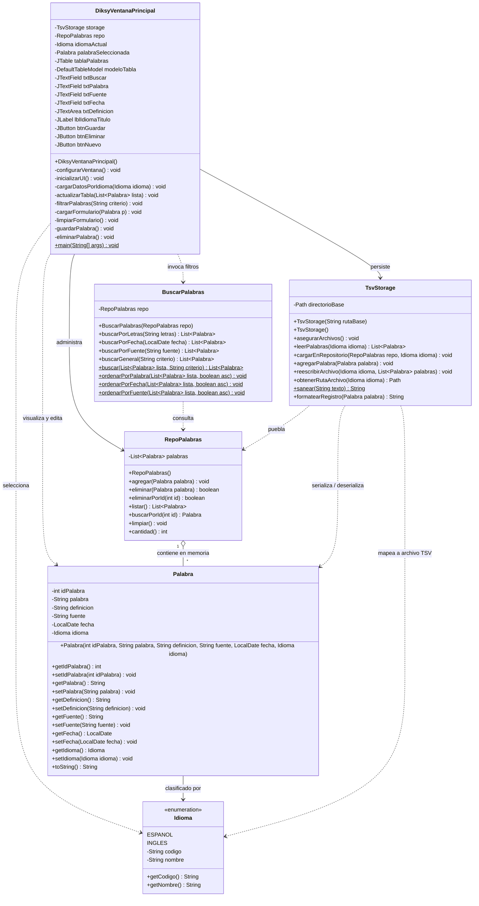
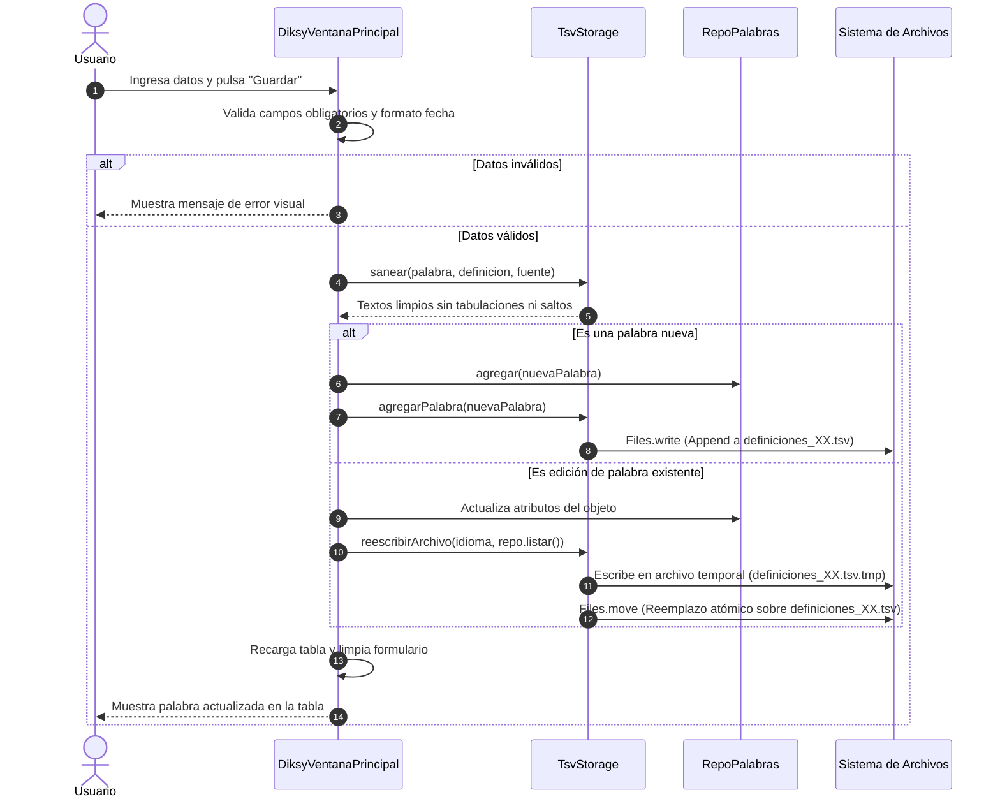

# Arquitectura del Sistema, UML y Especificación de Casos de Uso

---

## 1. Arquitectura en Capas

El sistema Diksy adopta una arquitectura desacoplada en tres capas principales:

```mermaid
flowchart TD
    subgraph Presentacion ["Capa de Presentación (com.diksy.gui)"]
        UI["DiksyVentanaPrincipal (Swing + FlatLaf)"]
    end

    subgraph Logica ["Capa de Lógica y Dominio (com.diksy)"]
        Repo["RepoPalabras (Gestión en memoria)"]
        Buscador["BuscarPalabras (Filtro y Collator)"]
        Modelo["Palabra / Idioma (Modelo de Dominio)"]
    end

    subgraph Persistencia ["Capa de Persistencia (com.diksy)"]
        Storage["TsvStorage (Lectura, parseo y escritura atómica)"]
    end

    subgraph Disco ["Almacenamiento Local (Sistema de Archivos)"]
        TSV_ES["datos/definiciones_es.tsv"]
        TSV_EN["datos/definiciones_en.tsv"]
    end

    UI -->|"Interactúa con"| Repo
    UI -->|"Consulta filtros a"| Buscador
    UI -->|"Usa modelo"| Modelo
    UI -->|"Solicita persistencia a"| Storage
    Repo o-- Modelo
    Buscador ..> Repo
    Buscador ..> Modelo
    Storage ..> Modelo
    Storage -->|"Escribe de forma atómica en"| TSV_ES
    Storage -->|"Escribe de forma atómica en"| TSV_EN
```

---

## 2. Diagrama de Clases (UML)



> **Nota de diseño:** El campo `idPalabra` es un identificador autoincremental de sesión en memoria asignado por `TsvStorage` al leer cada registro. Facilita las operaciones de selección, edición y borrado en los modelos de la interfaz de usuario sin contaminar el archivo TSV físico.

---

## 3. Diagrama de Secuencia: Guardado Seguro y Atómico

Ilustración de la interacción entre componentes cuando el usuario guarda una palabra (nueva o editada):



---

## 4. Casos de Uso y Situaciones a Considerar

> **Guía de Nomenclatura:**
> - **CU-XX:** Código del **Caso de Uso** (ej. `CU-01` = Caso de Uso 1).
> - **SIT-XX.Y:** Código de **Situación o Flujo Alternativo** correspondiente (ej. `SIT-01.2`).
> - **SIT-GEN-XX:** Código de **Situación General** del sistema (transversal).

---

### Situaciones Generales del Sistema (Transversales)

* **SIT-GEN-01 — Primer uso (Archivos inexistentes):**  
  * *Condición:* La carpeta `datos/` o los archivos `definiciones_es.tsv` / `definiciones_en.tsv` no existen al iniciar la aplicación.
  * *Acción del sistema:* `TsvStorage.asegurarArchivos()` crea automáticamente la carpeta y los archivos con su encabezado canónico (`fecha\tpalabra\tfuente\tdefinicion`). La aplicación inicia con normalidad.
* **SIT-GEN-02 — Archivo dañado o con líneas truncadas:**  
  * *Condición:* Un archivo TSV contiene una línea con número de columnas distinto de 4.
  * *Acción del sistema:* Registra una advertencia en la consola/registro, ignora la línea defectuosa y carga todas las líneas válidas sin interrumpir la ejecución.
* **SIT-GEN-03 — Problemas de permisos o disco lleno:**  
  * *Condición:* El sistema operativo no permite escribir en el disco por falta de espacio o restricciones de permisos.
  * *Acción del sistema:* Captura `IOException` y presenta un cuadro modal de alerta al usuario: *"No se pudo guardar la información por problemas de acceso al disco"*.
* **SIT-GEN-04 — Codificación UTF-8 garantizada:**  
  * *Condición:* Manipulación de caracteres especiales en español (á, é, í, ó, ú, ü, ñ, ¿, ¡).
  * *Acción del sistema:* Se fuerza `StandardCharsets.UTF_8` en todas las operaciones de entrada/salida para evitar *mojibake*.

---

### CU-01 — Registrar palabra

**Actor:** Usuario  
**Descripción:** El usuario registra una nueva palabra junto con su definición, fuente e idioma correspondiente.  
**Precondiciones:** La aplicación se encuentra en ejecución y el formulario de alta está accesible.

**Flujo principal:**
1. El usuario se sitúa en el formulario de alta.
2. El usuario ingresa la palabra.
3. El usuario ingresa la definición.
4. El usuario ingresa la fuente de donde obtuvo la información.
5. El usuario selecciona el idioma activo (Español o Inglés).
6. El sistema propone automáticamente la fecha actual (`AAAA-MM-DD`).
7. El usuario confirma el registro (pulsando el botón "Guardar" o atajo de teclado).
8. El sistema valida los datos ingresados.
9. El sistema sanea el texto mediante `TsvStorage.sanear()` eliminando tabulaciones o saltos de línea.
10. El sistema almacena la palabra en memoria (`RepoPalabras`) y la anexa al archivo TSV correspondiente.
11. El sistema limpia el formulario y actualiza la lista visual.

**Resultado esperado:** La palabra queda guardada en el archivo del idioma correspondiente y se visualiza en la tabla.

**Situaciones y Flujos Alternativos:**
* **SIT-01.1 — Campos obligatorios vacíos o con solo espacios:**  
  * *Condición:* La palabra o la definición no contienen texto visible.
  * *Acción del sistema:* Se detiene el guardado, se resalta visualmente el error y se notifica al usuario: *"La palabra y la definición son campos obligatorios"*.
* **SIT-01.2 — Ingreso accidental de caracteres delimitadores (`\t`, `\n`, `\r`):**  
  * *Condición:* El usuario pegó texto que contiene tabulaciones o retornos de carro.
  * *Acción del sistema:* Se reemplazan automáticamente por espacios simples y se aplica `trim()`, protegiendo la estructura de columnas.
* **SIT-01.3 — Registro de palabra repetida:**  
  * *Condición:* Ya existe un registro con el mismo vocablo.
  * *Acción del sistema:* Se admite el registro (permitiendo múltiples acepciones o fuentes distintas) sin bloquear al usuario.
* **SIT-01.4 — Modificación previa de la fecha:**  
  * *Condición:* El usuario necesita registrar una fecha anterior.
  * *Acción del sistema:* Valida que cumpla el formato `AAAA-MM-DD` mediante `LocalDate.parse()`. Si es inválida, alerta al usuario.

---

### CU-02 — Consultar palabras

**Actor:** Usuario  
**Descripción:** El usuario visualiza la lista de palabras almacenadas según el idioma seleccionado.  
**Precondiciones:** La aplicación está abierta y los datos cargados en memoria.

**Flujo principal:**
1. El usuario selecciona el idioma a consultar (panel lateral Español / Inglés).
2. El sistema carga las palabras del archivo TSV correspondiente en el repositorio en memoria.
3. El sistema muestra la tabla con las columnas: Fecha, Palabra, Fuente y Definición.

**Resultado esperado:** Se presentan de forma ordenada los registros existentes en el idioma activo.

**Situaciones y Flujos Alternativos:**
* **SIT-02.1 — Repositorio o archivo sin registros:**  
  * *Condición:* El archivo del idioma seleccionado está vacío o solo contiene la cabecera.
  * *Acción del sistema:* La tabla permanece limpia sin arrojar errores.
* **SIT-02.2 — Textos largos de definición en la tabla:**  
  * *Condición:* Una definición excede el ancho visual de la columna.
  * *Acción del sistema:* Al hacer clic en la fila de la tabla, la definición completa se muestra con ajuste de línea en el área de texto lateral.
* **SIT-02.3 — Cambio dinámico de idioma:**  
  * *Condición:* El usuario pulsa sobre otro botón de idioma en la barra lateral.
  * *Acción del sistema:* La tabla y el repositorio se actualizan de inmediato para reflejar el idioma elegido, limpiando la selección previa.

---

### CU-03 — Buscar palabra

**Actor:** Usuario  
**Descripción:** El usuario filtra las palabras para localizar un término, definición o fuente específica en tiempo real.  
**Precondiciones:** Se encuentra visible la lista de palabras del idioma seleccionado.

**Flujo principal:**
1. El usuario escribe en la barra superior de búsqueda.
2. El sistema filtra en tiempo real mediante `BuscarPalabras.buscar()`.
3. La tabla se refresca mostrando únicamente las coincidencias encontradas.

**Resultado esperado:** La tabla muestra solo los registros que coinciden con el criterio de búsqueda.

**Situaciones y Flujos Alternativos:**
* **SIT-03.1 — Búsqueda sin coincidencias:**  
  * *Condición:* Ningún registro contiene el texto ingresado.
  * *Acción del sistema:* La tabla muestra cero filas sin generar fallas.
* **SIT-03.2 — Insensibilidad a mayúsculas, minúsculas y espacios:**  
  * *Condición:* El usuario busca "ubiquitous", "Ubiquitous" o introduce espacios laterales.
  * *Acción del sistema:* Aplica `trim().toLowerCase()`, garantizando coincidencias sin importar cómo fue escrito.
* **SIT-03.3 — Búsqueda por múltiples campos:**  
  * *Condición:* El usuario recuerda un fragmento de la definición o de la fuente pero no el vocablo exacto.
  * *Acción del sistema:* El buscador examina simultáneamente los campos palabra, definición y fuente.
* **SIT-03.4 — Limpieza de búsqueda:**  
  * *Condición:* El usuario vacía el campo de texto de búsqueda.
  * *Acción del sistema:* Restaura de inmediato la lista completa de palabras del idioma activo.

---

### CU-04 — Editar palabra

**Actor:** Usuario  
**Descripción:** El usuario modifica la definición, fuente o término de una palabra ya guardada.  
**Precondiciones:** Existe al menos una palabra seleccionada en la lista.

**Flujo principal:**
1. El usuario hace clic sobre una fila de la tabla.
2. El sistema carga los datos en el formulario lateral y habilita el modo edición.
3. El usuario modifica el término, la fuente o la definición.
4. El usuario presiona el botón "Guardar Cambios".
5. El sistema valida y sanea los datos.
6. El sistema reescribe atómicamente el archivo TSV correspondiente (`.tmp` -> `.tsv`).
7. La tabla y el repositorio en memoria reflejan los datos actualizados.

**Resultado esperado:** La palabra queda actualizada tanto en memoria como en el archivo en disco.

**Situaciones y Flujos Alternativos:**
* **SIT-04.1 — Cancelar edición o nuevo registro:**  
  * *Condición:* El usuario decide no modificar la palabra o comenzar un registro en blanco.
  * *Acción del sistema:* Al presionar el botón "Nuevo / Limpiar", se resetea la selección activa y se limpian los campos del formulario.
* **SIT-04.2 — Escritura atómica y segura:**  
  * *Condición:* Guardado tras una modificación.
  * *Acción del sistema:* Escribe primero en un archivo temporal (`.tmp`) y luego renombra atómicamente sobre el archivo original.

---

### CU-05 — Eliminar palabra

**Actor:** Usuario  
**Descripción:** El usuario quita permanentemente un registro del sistema.  
**Precondiciones:** Existe al menos una palabra seleccionada en la tabla.

**Flujo principal:**
1. El usuario selecciona la palabra que desea remover.
2. El usuario presiona el botón "Eliminar".
3. El sistema solicita confirmación explícita mediante un cuadro de diálogo (`JOptionPane.showConfirmDialog`).
4. El usuario confirma la eliminación ("Sí").
5. El sistema remueve el registro del repositorio y reescribe de forma atómica el archivo TSV en disco.
6. La lista visual y el formulario se actualizan de inmediato.

**Resultado esperado:** La palabra deja de existir en memoria y en el archivo TSV.

**Situaciones y Flujos Alternativos:**
* **SIT-05.1 — Cancelación de la eliminación:**  
  * *Condición:* El usuario presiona "No" o cancela el diálogo.
  * *Acción del sistema:* Se aborta la operación manteniendo los datos intactos.
* **SIT-05.2 — Intento de eliminar sin elemento seleccionado:**  
  * *Condición:* El usuario presiona el botón de eliminar sin haber elegido una fila.
  * *Acción del sistema:* El botón permanece deshabilitado o emite un mensaje indicando que se debe seleccionar una palabra primero.

---

### CU-06 — Ordenar palabras

**Actor:** Usuario  
**Descripción:** El usuario organiza las palabras alfabéticamente, por fecha o por fuente.  
**Precondiciones:** Se visualiza la lista de palabras del idioma seleccionado.

**Flujo principal:**
1. Se invocan los métodos de ordenamiento de `BuscarPalabras`.
2. El sistema ordena la colección en memoria según el criterio seleccionado.
3. La tabla se refresca mostrando las palabras con el nuevo orden.

**Situaciones y Flujos Alternativos:**
* **SIT-06.1 — Orden alfabético con caracteres en español (Tildes y Ñ):**  
  * *Condición:* Ordenar palabras alfabéticamente.
  * *Acción del sistema:* Utiliza `java.text.Collator.getInstance(Locale.forLanguageTag("es-ES"))` para que caracteres acentuados y la letra *Ñ* sigan la norma del español.
* **SIT-06.2 — Inversión de orden (Ascendente / Descendente):**  
  * *Condición:* El parámetro `ascendente` es alternado.
  * *Acción del sistema:* Invierte la dirección del comparador.
